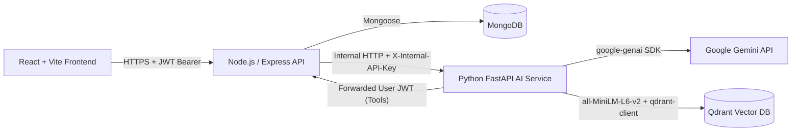

# CareerAI – AI-Powered Job Recommendation & Career Assistant


---

## 1. Project Overview

Job seekers—especially students, recent graduates, and early-career engineers—often struggle to understand why their resumes fail automated screening, which roles genuinely fit their skill set, and which missing skills will yield the highest career return.

**CareerAI** addresses these challenges with a three-tier full-stack architecture combining a React SaaS dashboard, a Node.js/Express API gateway backed by MongoDB, and a Python/FastAPI AI microservice:

- **Structured Resume Intelligence:** Extracts text from uploaded PDF resumes and parses skills, education, work experience, and projects into structured profiles with ATS readiness feedback.
- **Intelligent Job Discovery:** Replaces pure keyword matching with 384-dimensional vector embeddings (`sentence-transformers/all-MiniLM-L6-v2`) and Qdrant cosine similarity search with metadata filtering.
- **Personalized Guidance & Roadmaps:** Combines hybrid job ranking, deterministic skill-gap comparison, and a stateful LangGraph Career Assistant backed by persistent conversation history.

---

## 2. Key Features

- **Resume Upload and Analysis:** Drag-and-drop PDF upload (`<= 5 MB`) with MIME, extension, and `%PDF-` magic-byte validation, text extraction via `pypdf`, and structured parsing via `google-genai`.
- **ATS Score and Resume Insights:** Tracks section completeness (Summary, Technical Skills, Experience, Projects, Education), ATS score, strengths, and improvement recommendations.
- **Semantic Job Search:** Natural-language search over job embeddings stored in Qdrant (`careerai_jobs`) with metadata filters for location, experience level, employment type, work mode, and required skills, plus automatic MongoDB keyword fallback.
- **Hybrid Job Recommendation Engine:** Blends semantic vector similarity (when Qdrant is available) with deterministic skill overlap, experience-level alignment, desired-role match, and location preference.
- **AI Career Assistant using LangGraph:** Stateful `StateGraph` agent (`understand_intent -> execute_tools -> synthesize_response`) supporting both a Gemini provider (ready for API configuration) and a clearly labelled deterministic mock provider.
- **Tool Calling Architecture:** Six modular tools (`search_jobs`, `get_candidate_profile`, `get_resume_analysis`, `recommend_jobs`, `analyze_skill_gaps`, `generate_career_roadmap`) connected to real backend and vector services without fabricating listings.
- **Conversation Memory:** Multi-turn conversation threads persisted in MongoDB (`/api/conversations`) and isolated per authenticated user.
- **Skill Gap Analysis:** Compares a candidate's saved profile and parsed resume skills against a target role or specific job listing to compute a transparent skill-match percentage and ranked learning priorities.
- **Personalized Career Roadmap:** Generates structured 4-stage learning roadmaps with skills to learn, suggested projects, practical milestones, estimated timelines, and explicit planning assumptions.
- **User Authentication and Profile Management:** JWT authentication, bcrypt password hashing, protected React routes, session hydration via `/api/auth/me`, and editable candidate preferences.
- **Saved Jobs:** Idempotent bookmarking (`POST`, `GET`, `DELETE /api/saved-jobs`) persisted in MongoDB.
- **Dashboard and Career Insights:** Consolidated SaaS workspace displaying resume readiness, match statistics, recommended jobs, saved jobs, recent activity, and top skill gaps.

---

## 3. Screenshots


---

## 4. System Architecture

CareerAI separates client rendering, application security/persistence, and AI/ML workloads across three services:

1. **React Frontend (`frontend/`):** Single-page SaaS application built with React 19, Vite, Tailwind CSS, and React Router. Communicates exclusively with the Node.js backend via Axios with JWT Bearer injection.
2. **Node.js / Express Backend (`backend/`):** Acts as the public API gateway and persistence layer. Handles JWT auth, Zod validation, Multer memory uploads, rate limiting, MongoDB CRUD via Mongoose, hybrid recommendation scoring, skill-gap calculations, and internal HTTP calls to FastAPI.
3. **Python / FastAPI AI Service (`ai-service/`):** Owns PDF parsing (`pypdf`), Google Gemini structured extraction (`google-genai`), local `sentence-transformers` embedding generation, Qdrant vector operations (`qdrant-client`), and the LangGraph assistant workflow.
4. **MongoDB Persistence:** Stores `User`, `Resume`, `Job`, `SavedJob`, and `Conversation` collections.
5. **Qdrant Vector Database:** Stores 384-dimensional cosine-normalized job vectors (`careerai_jobs`) and filterable metadata payloads, configured via `QDRANT_URL` and `QDRANT_API_KEY` for compatibility with Qdrant Cloud.



---

## 5. Technology Stack

| Category | Technologies Used |
| :--- | :--- |
| **Frontend** | React 19, Vite 7, Tailwind CSS 3, React Router DOM 7, Axios, Lucide React |
| **Backend** | Node.js, Express 4, Mongoose 8, Zod, Multer 2, Helmet, CORS, Express Rate Limit |
| **AI / ML** | Python 3.11+, FastAPI, Pydantic v2, Google Gen AI SDK (`google-genai`), `pypdf`, Sentence Transformers (`sentence-transformers/all-MiniLM-L6-v2`), LangGraph, LangChain Core |
| **Database & Vector Search** | MongoDB, Qdrant (`qdrant-client`), `mongodb-memory-server` (automated test harness) |
| **Authentication & Tools** | JSON Web Tokens (`jsonwebtoken`), `bcryptjs`, `httpx`, `pytest`, `node:test`, Git |

---

## 6. Project Folder Structure

```text
career-ai/
├── .env.example
├── .gitignore
├── README.md
├── docker/
│   └── docker-compose.yml            # Optional Qdrant service config (not used at this stage)
├── frontend/
│   ├── .env.example
│   ├── index.html
│   ├── package.json
│   ├── postcss.config.js
│   ├── tailwind.config.js
│   ├── vite.config.js
│   └── src/
│       ├── App.jsx
│       ├── index.css
│       ├── main.jsx
│       ├── api/
│       │   └── client.js
│       ├── components/
│       │   ├── auth/                 # ProtectedRoute.jsx, PublicOnlyRoute.jsx
│       │   ├── common/               # MatchBadge.jsx, SectionCard.jsx, SkillBadge.jsx, StatCard.jsx
│       │   ├── jobs/                 # JobCard.jsx, JobDetailModal.jsx
│       │   └── layout/               # AppLayout.jsx, Sidebar.jsx, Topbar.jsx
│       ├── context/                  # AuthContext.jsx, CareerContext.jsx
│       ├── data/                     # mockData.js
│       ├── pages/                    # DashboardPage, ResumeAnalyzerPage, JobExplorerPage,
│       │                             # CareerInsightsPage, AssistantPage, ProfilePage,
│       │                             # LoginPage, RegisterPage, NotFoundPage
│       └── services/                 # assistantService, authService, careerService,
│                                     # jobService, profileService, resumeService, savedJobService
├── backend/
│   ├── .env.example
│   ├── package.json
│   ├── README.md
│   ├── src/
│   │   ├── app.js
│   │   ├── server.js
│   │   ├── config/                   # db.js, env.js
│   │   ├── controllers/              # auth, career, conversation, job, recommendation,
│   │   │                             # resume, savedJob, user controllers
│   │   ├── middleware/               # auth, error, upload, validate middlewares
│   │   ├── models/                   # Conversation.js, Job.js, Resume.js, SavedJob.js, User.js
│   │   ├── routes/                   # auth, career, conversation, health, job,
│   │   │                             # recommendation, resume, savedJob, user routes
│   │   ├── seed/                     # seedJobs.js (22 jobs), syncQdrant.js
│   │   ├── services/                 # aiVectorService, jobService, recommendationService, skillGapService
│   │   └── utils/                    # ApiError.js, asyncHandler.js
│   └── tests/                        # assistantMemory, backend, career, integrationAudit, semanticSearch
└── ai-service/
    ├── .env.example
    ├── README.md
    ├── requirements.txt
    ├── app/
    │   ├── __init__.py
    │   ├── config.py
    │   ├── main.py
    │   ├── agent/                    # graph.py, llm_provider.py, state.py, tools.py
    │   ├── middleware/               # security.py
    │   ├── routes/                   # assistant.py, embeddings.py, health.py, resume.py
    │   ├── schemas/                  # assistant.py, embedding.py, resume.py
    │   └── services/                 # embedding_service.py, gemini_service.py,
    │                                 # pdf_service.py, qdrant_service.py
    └── tests/                        # test_assistant.py, test_embeddings.py, test_health.py, test_resume.py
```

---

## 7. Installation and Local Setup

### Prerequisites
- Node.js >= 20
- Python >= 3.11
- MongoDB connection string (MongoDB Atlas or local MongoDB) for live persistence
- Optional: Qdrant instance or Qdrant Cloud credentials for live vector search, and a Google Gemini API key for live LLM extraction and synthesis

### 1. AI Service (`ai-service/`)
```powershell
cd ai-service
python -m venv .venv
.\.venv\Scripts\activate
pip install -r requirements.txt
copy .env.example .env
uvicorn app.main:app --reload --port 8000
```

### 2. Backend API (`backend/`)
```powershell
cd backend
npm install
copy .env.example .env
# Add MONGO_URI and JWT_SECRET to backend/.env before seeding
npm run seed          # Seeds 22 technology job listings into MongoDB
npm run sync:qdrant   # Optional: indexes MongoDB jobs into Qdrant via FastAPI
npm run dev           # Starts Express on http://localhost:5000
```

### 3. Frontend (`frontend/`)
```powershell
cd frontend
npm install
copy .env.example .env
npm run dev           # Starts Vite dev server on http://localhost:5173
```

---

## 8. Environment Variables

All environment templates use empty placeholders for secrets. **Actual external API credentials have not yet been configured in this repository**, and real `.env` files are excluded by `.gitignore`.

### Backend (`backend/.env.example`)
| Variable | Required | Default / Purpose |
| :--- | :--- | :--- |
| `PORT` | Optional | `5000` |
| `NODE_ENV` | Optional | `development` |
| `MONGO_URI` | Required for DB routes | MongoDB connection string |
| `JWT_SECRET` | Required in production | Secret for signing JWT Bearer tokens |
| `JWT_EXPIRES_IN` | Optional | `7d` |
| `CORS_ORIGIN` | Optional | `http://localhost:5173` |
| `AI_SERVICE_URL` | Optional | `http://localhost:8000` |
| `AI_SERVICE_TIMEOUT_MS` | Optional | `25000` |
| `INTERNAL_API_KEY` | Required for protected AI calls | Shared secret sent in `X-Internal-API-Key` |
| `MAX_RESUME_FILE_SIZE_MB` | Optional | `5` |

### AI Service (`ai-service/.env.example`)
| Variable | Required | Default / Purpose |
| :--- | :--- | :--- |
| `AI_PORT` | Optional | `8000` |
| `ENVIRONMENT` | Optional | `development` |
| `GEMINI_API_KEY` | For live Gemini calls | Google Gemini API key (empty uses mock assistant mode) |
| `GEMINI_MODEL` | Optional | Defaults to `gemini-2.5-flash` in `app/config.py` |
| `ASSISTANT_PROVIDER` | Optional | `auto` (`gemini` when key set, else `mock`), `gemini`, or `mock` |
| `INTERNAL_API_KEY` | Required for protected routes | Shared secret verified on `/ai/parse-resume` and `/ai/assistant/chat` |
| `BACKEND_URL` | For Assistant tools | `http://localhost:5000` |
| `MAX_RESUME_FILE_SIZE_MB` | Optional | `5` |
| `CORS_ORIGINS` | Optional | `http://localhost:5000` |
| `EMBEDDING_MODEL` | Optional | `sentence-transformers/all-MiniLM-L6-v2` |
| `EMBEDDING_DIMENSION` | Optional | `384` |
| `QDRANT_URL` | For live Qdrant | `http://localhost:6333` (or Qdrant Cloud URL) |
| `QDRANT_API_KEY` | For Qdrant Cloud | Empty for unauthenticated local Qdrant |
| `QDRANT_COLLECTION` | Optional | `careerai_jobs` |

### Frontend (`frontend/.env.example`)
| Variable | Required | Default / Purpose |
| :--- | :--- | :--- |
| `VITE_API_BASE_URL` | Optional | `http://localhost:5000/api` |

---

## 9. API Endpoints

### Backend API (`http://localhost:5000/api`)
| Domain | Method | Path | Auth | Description |
| :--- | :--- | :--- | :--- | :--- |
| Health | `GET` | `/api/health` (and `/api/v1/health`) | Public | Backend, MongoDB, and AI service status |
| Auth | `POST` | `/api/auth/register` | Public | Register user, hash password, issue JWT |
| Auth | `POST` | `/api/auth/login` | Public | Authenticate credentials, issue JWT |
| Auth | `GET` | `/api/auth/me` | JWT | Return current authenticated user |
| Users | `GET` | `/api/users/profile` | JWT | Get authenticated user's profile |
| Users | `PUT` | `/api/users/profile` | JWT | Update profile, skills, and preferences |
| Resumes | `POST` | `/api/resumes/upload` | JWT | Upload PDF (`resume`), validate, parse, save |
| Resumes | `GET` | `/api/resumes` | JWT | List resumes owned by current user |
| Resumes | `GET` | `/api/resumes/:id` | JWT | Retrieve single resume (`403` cross-user guard) |
| Jobs | `GET` | `/api/jobs` | Public | Paginated and filtered job catalog |
| Jobs | `GET` | `/api/jobs/search` | Public | Semantic Qdrant search with keyword fallback |
| Jobs | `GET` | `/api/jobs/:id` | Public | Get job details by ID |
| Jobs | `POST` | `/api/jobs` | JWT | Create job and attempt Qdrant indexing |
| Jobs | `POST` | `/api/jobs/sync-vectors` | JWT | Batch index all MongoDB jobs into Qdrant |
| Recommend | `GET` | `/api/recommendations` | JWT | Hybrid semantic and deterministic job ranking |
| Saved Jobs | `GET` | `/api/saved-jobs` | JWT | List bookmarked jobs for current user |
| Saved Jobs | `POST` | `/api/saved-jobs/:jobId` | JWT | Save a job idempotently |
| Saved Jobs | `DELETE` | `/api/saved-jobs/:jobId` | JWT | Remove a saved job |
| Conversations | `GET` | `/api/conversations` | JWT | List user's conversations |
| Conversations | `POST` | `/api/conversations` | JWT | Create or append turn via LangGraph assistant |
| Conversations | `GET` | `/api/conversations/:id` | JWT | Retrieve conversation (`403` cross-user guard) |
| Career | `POST` | `/api/career/skill-gap` | JWT | Skill gap analysis against job or target role |
| Career | `POST` | `/api/career/roadmap` | JWT | Structured 4-stage personalized career roadmap |

### AI Service (`http://localhost:8000`)
| Method | Path | Auth | Description |
| :--- | :--- | :--- | :--- |
| `GET` | `/health` | Public | Service readiness and Gemini config status |
| `POST` | `/ai/parse-resume` | `X-Internal-API-Key` | PDF validation, `pypdf` extraction, Gemini structured parsing |
| `GET` | `/ai/embedding/health` | Public | Embedding model and Qdrant collection status |
| `POST` | `/ai/embedding/generate` | Optional `X-Internal-API-Key` | L2-normalized 384-dim embeddings (`query`, `job`, `candidate`) |
| `POST` | `/ai/embedding/index-job` | Optional `X-Internal-API-Key` | Index a single job vector and metadata payload |
| `POST` | `/ai/embedding/index-jobs` | Optional `X-Internal-API-Key` | Batch index up to 200 jobs into Qdrant |
| `POST` | `/ai/embedding/search` | Optional `X-Internal-API-Key` | Vector similarity search with metadata filters |
| `POST` | `/ai/embedding/search-candidate` | Optional `X-Internal-API-Key` | Candidate-profile semantic job retrieval |
| `DELETE` | `/ai/embedding/jobs/{job_id}` | Optional `X-Internal-API-Key` | Delete job point by canonical `job_id` |
| `GET` | `/ai/assistant/health` | Public | Assistant provider (`mock` vs `gemini`) and available tools |
| `POST` | `/ai/assistant/chat` | `X-Internal-API-Key` | Execute LangGraph Career Assistant workflow |

---

## 10. AI Architecture

1. **Resume Parsing Flow:** Express validates the uploaded PDF (`multer.memoryStorage()`, `.pdf`, `<= 5 MB`, `%PDF-` header) and forwards it to `POST /ai/parse-resume`. FastAPI extracts text via `pypdf` (rejecting corrupted, encrypted, or scanned image-only PDFs with `422`) and passes it to `google-genai` using a Pydantic structured output schema (`_GeminiResumeSchema` mapped to `ParsedResumeProfile`).
2. **Embedding Generation:** `embedding_service.py` lazily loads and caches `sentence-transformers/all-MiniLM-L6-v2`, formats job descriptions, candidate profiles, or queries, and enforces L2 normalization (`384` dimensions).
3. **Vector Indexing & Retrieval:** `qdrant_service.py` initializes `careerai_jobs` (`size=384`, `COSINE` distance) with keyword payload indexes (`location`, `experienceLevel`, `employmentType`, `workMode`, `requiredSkills`) and maps MongoDB job IDs to deterministic UUIDv5 point IDs for duplicate-safe upserts.
4. **Hybrid Recommendation Scoring:** In `recommendationService.js`, when Qdrant returns semantic hits (`hybrid_semantic`), scores blend:
   - `0.40 * semanticSimilarity + 0.35 * skillRatio + 0.15 * experienceFit + 0.05 * roleMatch + 0.05 * locationMatch`
   - When Qdrant is offline (`deterministic_fallback`), scoring uses `0.55 * skillRatio + 0.20 * experienceFit + 0.15 * roleMatch + 0.10 * locationMatch`.
5. **LangGraph Workflow:** `app/agent/graph.py` defines a compiled `StateGraph(AgentState)` with nodes `understand_intent -> execute_tools -> synthesize_response`. Tool failures are captured in `toolTrace` without crashing the graph or fabricating results.
6. **Conversation Memory:** Canonical chat history is stored in MongoDB (`Conversation` model) through Express `/api/conversations`. Express forwards the recent message window and user JWT to FastAPI `/ai/assistant/chat` and saves each user/assistant turn back to MongoDB.

---

## 11. Testing

All automated tests below were run and observed passing in the current workspace. External service integrations were verified using mocks and in-memory engines where live credentials are not configured (`mongodb-memory-server`, deterministic fake encoders, Qdrant `:memory:`, and mocked `google-genai` clients), alongside live local HTTP communication between Express and FastAPI.

### AI Service (`15 passed, 0 failed`)
```powershell
cd ai-service
.\.venv\Scripts\python.exe -m pytest -v
```
Covers `/health`, `test_resume.py` (internal auth, PDF validation, corrupted/scanned PDFs, timeouts, invalid JSON, mocked Gemini), `test_embeddings.py` (384-dim vectors, L2 normalization, caching, Qdrant `:memory:` collection/upsert/delete/metadata filtering), and `test_assistant.py` (all 6 tools independently, LangGraph workflow, tool failure handling, mock & mocked-Gemini providers).

### Backend (`22 passed, 0 failed`)
```powershell
cd backend
node --test --test-concurrency=1 tests/backend.test.js tests/integrationAudit.test.js tests/semanticSearch.test.js tests/assistantMemory.test.js tests/career.test.js
```
Covers auth, JWT protection, user profile, resume upload/ownership, job CRUD/search/seeding, hybrid recommendations, saved jobs, skill-gap & roadmap endpoints, MongoDB-unavailable `503` handling, live Express-to-FastAPI error propagation, MongoDB-to-Qdrant batch sync, and multi-turn conversation memory isolation.

### Frontend Production Build (`passed`)
```powershell
cd frontend
npm run build
```
Compiled cleanly with Vite (`1691` modules transformed).

---

## 12. Current Limitations

- **Live Gemini API verification pending:** Live `google-genai` API calls for resume parsing and assistant synthesis have not yet been executed against Google's servers because `GEMINI_API_KEY` is not yet configured.
- **MongoDB Atlas connection pending:** Database persistence has been verified against `mongodb-memory-server`, not a hosted MongoDB Atlas cluster.
- **Qdrant Cloud connection pending:** Vector indexing and similarity search have been verified against Qdrant `:memory:` and offline fallbacks, not a live Qdrant Cloud instance.
- **Sentence Transformer weights unverified live:** Unit tests used a deterministic fake encoder to avoid repeated model downloads; live inference with downloaded HuggingFace weights has not yet been run end-to-end.
- **No OCR support for scanned PDFs:** Image-only PDFs without embedded text return `422 SCANNED_OR_EMPTY_PDF`.

---

## 13. Future Improvements

- **OCR Pipeline:** Add OCR support (e.g., Tesseract or multimodal document extraction) for scanned image-only PDF resumes.
- **Production Deployment & Containerization:** Complete multi-service container orchestration and cloud hosting configuration once live credentials are provisioned.
- **LLM & Retrieval Evaluation Suite:** Add automated Precision@K, MRR, and LLM-as-a-judge faithfulness benchmarks across golden resume and job datasets.
- **Recommendation Refinements:** Incorporate user feedback signals (saved, viewed, and dismissed roles) and optional cross-encoder re-ranking.

---

## 14. Security

- **Environment Variables & Secret Hygiene:** Secrets (`GEMINI_API_KEY`, `MONGO_URI`, `JWT_SECRET`, `INTERNAL_API_KEY`, `QDRANT_API_KEY`) are loaded strictly from environment variables; `.gitignore` excludes `.env*` files while keeping `.env.example` templates free of credentials.
- **JWT & Password Security:** Passwords are hashed with `bcryptjs`; protected Express routes require Bearer JWT verification (`authMiddleware.js`) and enforce strict `userId` ownership (`403` on cross-user access to resumes or conversations).
- **Internal Service Authentication:** Protected FastAPI endpoints (`/ai/parse-resume`, `/ai/assistant/chat`) validate `X-Internal-API-Key` using constant-time comparison (`hmac.compare_digest`).
- **API Hardening & Input Validation:** Express configures `helmet`, scoped `cors`, `express-rate-limit`, Zod request validation, and in-memory Multer PDF validation (`<= 5 MB`, `%PDF-` signature) without serving uploaded files publicly. FastAPI request logging records only method, path, status, latency, and client IP—never resume text or keys.

---
